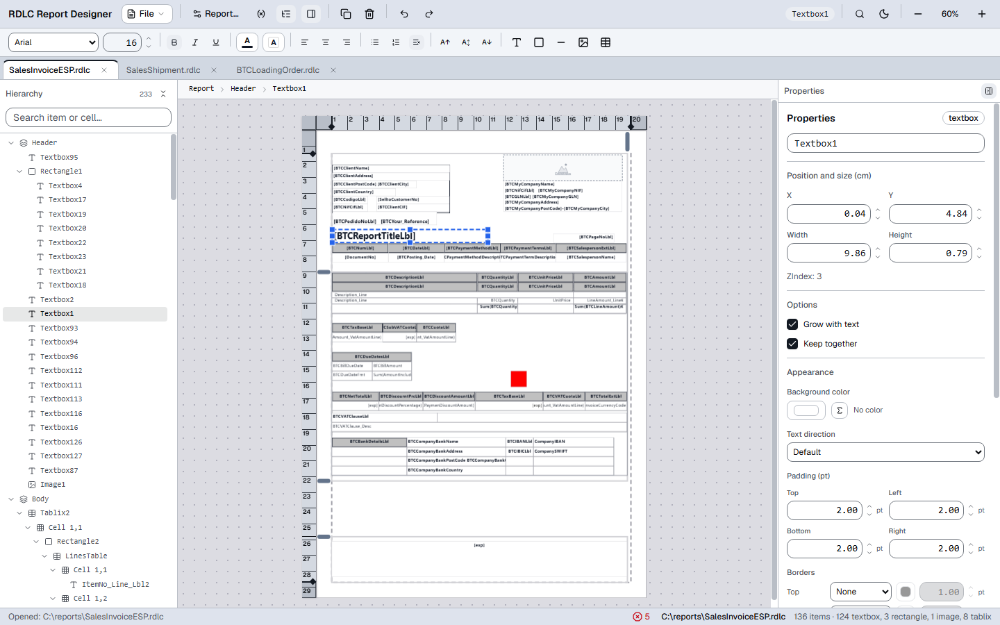
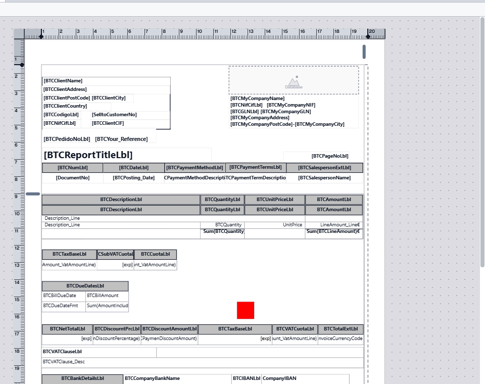
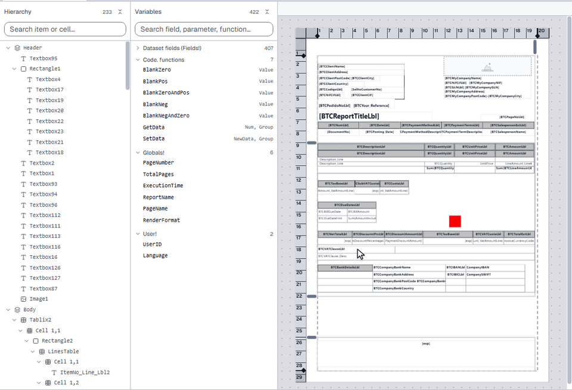
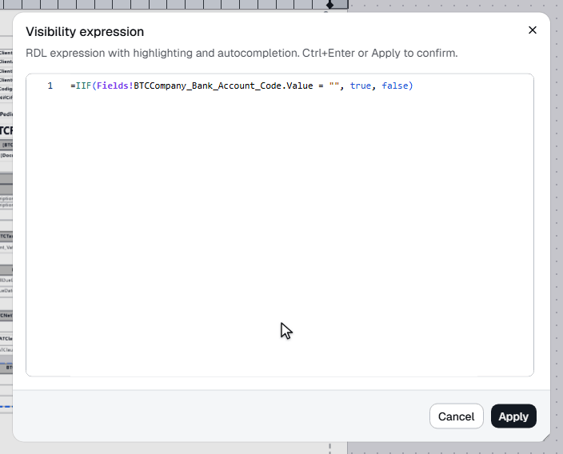
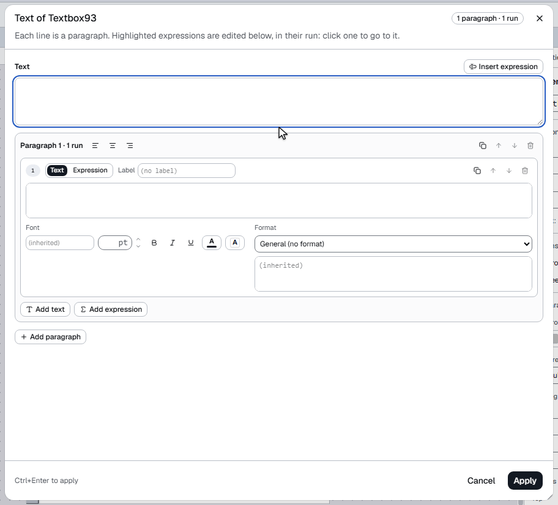
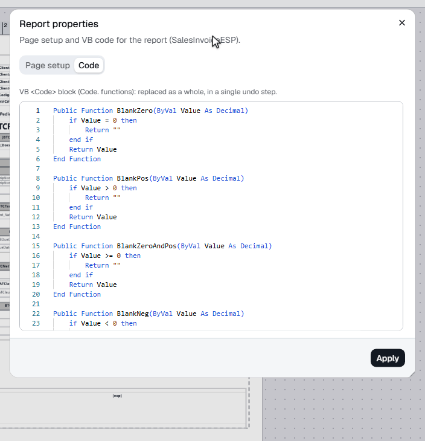
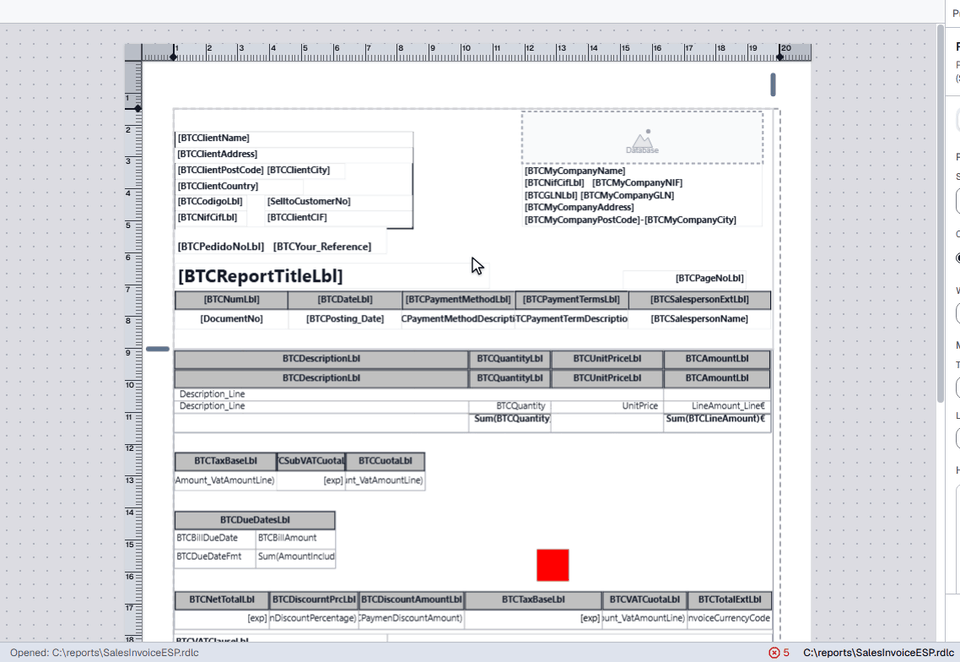
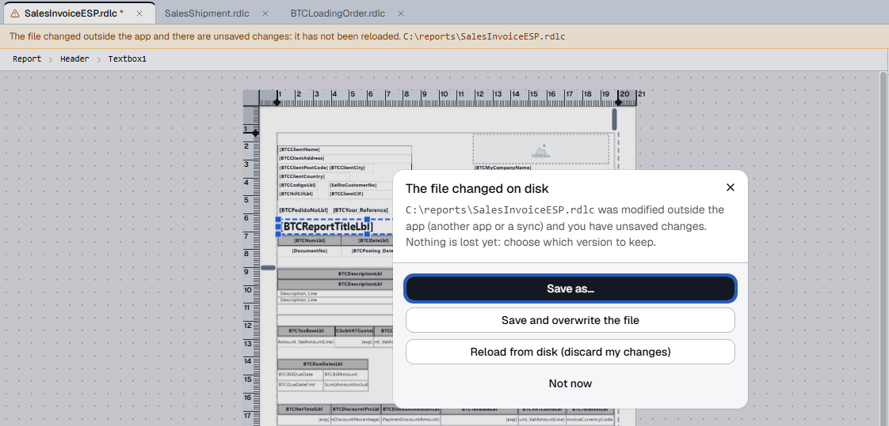

<div align="center">

# RDLC Report Designer

**Visual editor for Business Central `.rdlc` and SSRS `.rdl` reports.**
A modern alternative to Report Builder: edit the layout with your mouse and get XML that saves **without altering anything you didn't touch**.

**RDLC Report Designer MCP server:** let an AI agent (Claude Code, Claude Desktop, Cursor…) create and edit reports without opening the app — [setup](#mcp-server--edit-reports-from-an-agent).


[](./LICENSE)


<picture>
  <source media="(prefers-color-scheme: dark)" srcset="docs/assets/screenshot-dark.png">
  
</picture>

</div>

---

## Why

In my point of view, Microsoft Report Builder is old and lacks basic user experience features. With RDLC Report Designer I try to fill some gaps that I find in my day-to-day work with rdlc/rdl reports. The core ideas behind this software are:

- Offer modern features that greatly improve the user experience while designing reports, features like tabs, VB IntelliSense, elements hierarchy and so on...
- Offer coding agents an MCP that saves tokens and improves the agent's understanding of the report.
- Compatibility with what **Report Builder and BC** expect when opening the report.

## What's new compared to Report Builder

The canvas, tablix, text and styles work much like they do in Report Builder. This section only covers what Report Builder doesn't have.

### Tabs and dark mode

The screenshot above shows both. Each report opens in its own tab, so one window holds all your reports: unsaved reports are marked with `*`, <kbd>Ctrl</kbd>+<kbd>Tab</kbd> switches between them, and right-clicking a tab closes the other tabs or only the saved ones. The moon/sun button in the toolbar switches between the light and dark themes (the screenshot follows your GitHub theme).

### Command palette

<kbd>Ctrl</kbd>+<kbd>K</kbd> searches every editor action, every item in the report and every variable by name. Pick an item and the canvas selects it and scrolls to it.



### Hierarchy and Variables panels

**Hierarchy** shows every item as a tree (header, body, footer, rectangles, tablix cells) and follows the canvas selection. **Variables** lists the dataset fields, parameters, `Code.` functions with their arguments, `Globals!` and `User!`. Both panels have a search box.



### Expression editor with autocomplete

Expressions get syntax highlighting, line numbers and autocomplete for fields, parameters, `Code.` functions, `Globals!`, `User!` and RDL functions. <kbd>Ctrl</kbd>+<kbd>Enter</kbd> applies the change.



### Text editor

Double-click a textbox (or press <kbd>F2</kbd>) to edit its whole content in one dialog. Each line is a paragraph and expressions show as chips inside the text. **Insert expression at cursor** adds one where the caret is and opens its value editor, with the same autocomplete. Below the text you edit the paragraph under the caret: its alignment and each run (text or expression) with its own font, size, bold, italic, underline, colors and format. <kbd>Ctrl</kbd>+<kbd>Z</kbd> works across the whole dialog, and <kbd>Ctrl</kbd>+<kbd>Enter</kbd> applies everything as a single undo step.



### VB code editor

The report's `<Code>` block opens in the same editor instead of a plain text box: VB highlighting, line numbers and the same autocomplete. Open it from **Report… → Code**.



### Problems panel

The app checks the report's expressions for dataset fields that don't exist, references to report items that don't exist and unbalanced brackets. The status bar shows how many problems there are. Click a problem to select the item it belongs to.



### Live reload and conflict warnings

When the file changes on disk (for example after compiling the AL project), the open report reloads by itself. If you have unsaved changes, the app keeps them and asks which version to keep instead of overwriting either one. If the file is deleted, saving creates it again.



### English and Spanish

The interface follows the Windows language (English or Spanish). To switch, open <kbd>Ctrl</kbd>+<kbd>K</kbd> and pick **Switch language**.

## Installation

Download the installer from the repository's **Releases** section:

| File                                              | Use                      |
| ------------------------------------------------- | ------------------------ |
| `RDLC-Report-Designer-<version>-setup.exe`        | Classic installer (NSIS) |
| `RDLC-Report-Designer-<version>.msi`              | Corporate deployment     |
| `RDLC-Report-Designer-<version>-portable.exe`     | No installation          |
| `RDLC-Report-Designer-<version>-win-unpacked.zip` | Ready-to-run folder      |

You can also open a report from the command line or by dragging it onto the window:

```bash
"RDLC Report Designer.exe" C:\path\to\report.rdlc
```

## MCP server — edit reports from an agent

The repo ships a [Model Context Protocol](https://modelcontextprotocol.io) server (stdio) that lets an AI agent (Claude Code, Claude Desktop, Cursor…) create and edit `.rdlc`/`.rdl` layouts **without opening the app**: no GUI, no Electron. It runs the same editing engine as the desktop app, so the agent works with the same typed commands as the UI and keeps every guarantee: byte-for-byte round-trip, byte-exact undo, measure normalization and RDL 2016 XSD validation on save.

Published on npm as [`@jjp00/rdlc-designer-mcp`](https://www.npmjs.com/package/@jjp00/rdlc-designer-mcp) (requires Node.js 22+).

### Setup

**Claude Code:**

```bash
claude mcp add rdlc-designer -- npx -y @jjp00/rdlc-designer-mcp
claude mcp add rdlc-designer -- cmd /c npx -y @jjp00/rdlc-designer-mcp   # native Windows (not WSL)
```

Add `--scope user` for all your projects, or `--scope project` to write a shared `.mcp.json`.

**Other agents** (Claude Desktop, Cursor, VS Code, Codex…):

```jsonc
// Claude Desktop (claude_desktop_config.json), Cursor (.cursor/mcp.json)
{
  "mcpServers": {
    "rdlc-designer": { "command": "npx", "args": ["-y", "@jjp00/rdlc-designer-mcp"] },
  },
}
```

```jsonc
// VS Code (.vscode/mcp.json)
{
  "servers": {
    "rdlc-designer": {
      "type": "stdio",
      "command": "npx",
      "args": ["-y", "@jjp00/rdlc-designer-mcp"],
    },
  },
}
```

```toml
# Codex CLI (~/.codex/config.toml)
[mcp_servers.rdlc-designer]
command = "npx"
args = ["-y", "@jjp00/rdlc-designer-mcp"]
```

### Tools

| Tool                         | Purpose                                                                                    |
| ---------------------------- | ------------------------------------------------------------------------------------------ |
| `rdlc_open` / `rdlc_create`  | Open an existing `.rdlc`/`.rdl` or create a blank one (won't overwrite unless `overwrite`) |
| `rdlc_list_sessions`         | Open sessions, dirty state, version                                                        |
| `rdlc_get_report`            | Page, regions, item counts, dataset fields, parameters, VB code (`includeCode`)            |
| `rdlc_get_outline`           | Layout map (`region`, `id`, `maxLines` to bound it)                                        |
| `rdlc_get_item`              | Full JSON of one item                                                                      |
| `rdlc_find`                  | Find text/expressions/ids (and the `<Code>` block): item `id` + exact spot, replaces grep  |
| `rdlc_list_commands`         | Signatures of all commands, or the exact JSON Schema of the named ones (`names`)           |
| `rdlc_apply_commands`        | Apply a list of commands in order (`atomic`)                                               |
| `rdlc_undo` / `rdlc_redo`    | Session journal                                                                            |
| `rdlc_save` / `rdlc_save_as` | Save (validates the schema) or save a copy                                                 |
| `rdlc_reload` / `rdlc_close` | Re-read from disk discarding changes / close (`force` discards changes)                    |

Edits live in memory until `rdlc_save`. Dataset fields and parameters are read-only: in Business Central they come from the AL report dataset, so add the column in AL, compile, and re-open the regenerated `.rdlc`. Warnings that are dialogs in the GUI (conflict, deleted file, external reload) reach the agent as `notices` in the session's next response.

> Notes: only `.rdlc`/`.rdl` (2016/01 schema) files are accepted; the server has the file access of the process that launches it, so work on copies until you trust it; `RDLC_SCHEMA_PATH` overrides the bundled XSD. More in [docs/features/0004-servidor-mcp.md](./docs/features/0004-servidor-mcp.md) and the [package README](./packages/rdlc-mcp/README.md).

<details>
<summary><b>From the repo (development, no publish needed)</b></summary>

```bash
pnpm --filter @rdlc-designer/back build:mcp     # → apps/back/out/mcp/server.mjs
claude mcp add rdlc-designer -- node C:/path/to/ReportDesigner/apps/back/out/mcp/server.mjs

pnpm --filter @jjp00/rdlc-designer-mcp build    # → packages/rdlc-mcp/dist + resources
pnpm --filter @jjp00/rdlc-designer-mcp smoke    # npm pack + clean install + stdio check
```

</details>

## Development

**Requirements:** Node.js ≥ 22 and pnpm 9 (`npm install -g pnpm@9.15.4`).

```bash
pnpm install
pnpm --filter @rdlc-designer/back dev     # Electron in dev mode (renderer HMR)
```

| Command                                   | What it does                                                          |
| ----------------------------------------- | --------------------------------------------------------------------- |
| `pnpm test`                               | Unit tests (Vitest): golden round-trip, domain, application, frontend |
| `pnpm e2e`                                | Playwright against the Electron app (builds `out/` and runs the E2E)  |
| `pnpm typecheck`                          | `tsc` across all packages                                             |
| `pnpm lint` · `pnpm format:check`         | Lint and format                                                       |
| `pnpm --filter @rdlc-designer/back build` | Production build (main + preload + renderer)                          |
| `pnpm dist`                               | Windows installers (NSIS + MSI) in `apps/back/release/`               |
| `pnpm dist:dir`                           | Unpacked app, for a smoke test without an installer                   |

### Architecture

```
apps/back/            Electron main + NestJS (hexagon: domain / application / presentation / infrastructure)
apps/front/           React 19 — Tailwind v4 + shadcn/ui (radix-nova) + Konva
packages/contracts/   zod: shared commands, projection and IPC
packages/rdlc-mcp/    MCP server package (@jjp00/rdlc-designer-mcp)
fixtures/corpus/      10 real reports for the golden tests
docs/                 ADRs, performance, packaging, UX, bugs and feature designs
```

The renderer never touches the XML: it sends typed **commands** to the backend, which applies them to the _lossless_ tree (with their inverse for undo) and returns a **projection** to paint. More in the [architecture documentation](./RDLC%20Report%20Designer%20-%20arquitectura.md) and the ADRs: [lossless XML parser](./docs/adr/0001-parser-xml-lossless.md) · [NestJS in the main process](./docs/adr/0002-nest-en-electron-main.md).

<details>
<summary><b>Troubleshooting</b></summary>

- **`Error: Electron uninstall` when starting in dev:** pnpm didn't run Electron's postinstall. Download the binary manually: `node apps/back/node_modules/electron/install.js`.
- **The app starts as Node and fails with `does not provide an export named 'BrowserWindow'`:** the `ELECTRON_RUN_AS_NODE` environment variable is set in your terminal. Remove it (`Remove-Item Env:ELECTRON_RUN_AS_NODE`) and launch again.

</details>

<details>
<summary><b>Canvas benchmark</b></summary>

```bash
# 3 passes of the 972-textbox scenario on the production build
pnpm --filter @rdlc-designer/back bench
# Different size / number of passes: node apps/back/scripts/bench.mjs 5000 5
```

Current result: **59.5–59.9 fps p50** with 972 textboxes (budget 60). Details in [docs/perf](./docs/perf/).

</details>

<details>
<summary><b>QA mode: screenshots and scripts against the real app</b></summary>

Electron can open a report, run a script in the renderer and take a screenshot without touching anything by hand.

The screenshots and GIFs in this README come from a Playwright script that drives the real app in English: it records each scene with Chromium's screencast and builds the GIF with ffmpeg (which must be on the `PATH`). Regenerate them after UI changes:

```bash
pnpm --filter @rdlc-designer/back build:e2e
node apps/back/scripts/readme-media.mjs docs/assets                  # all scenes
node apps/back/scripts/readme-media.mjs docs/assets palette,text     # only some (comma-separated)
```

For one-off captures, use these environment variables instead:

```powershell
$env:RDLC_OPEN='C:\path\to\report.rdlc'     # file to open at startup
$env:RDLC_SHOT='C:\path\to\output.png'      # screenshot when done
$env:RDLC_SHOT_DELAY='6000'                 # ms before running the script
$env:RDLC_SHOT_DRAG='x1,y1,x2,y2'           # previous drag/click (window px)
$env:RDLC_SHOT_SCRIPT='...'                 # JS to evaluate in the renderer
$env:RDLC_SHOT_QUIT='1'                     # quit when done
pnpm --filter @rdlc-designer/back dev
```

In dev (and in the `--mode e2e` build) the renderer exposes hooks for scripts: `__rdlcSelection`, `__rdlcCell`, `__rdlcMenuHit`, `__rdlcResizeHandle`, `__rdlcStage` and `__rdlcProjection`. Interaction tests live in Playwright (`pnpm e2e`).

</details>

## License

[MIT](./LICENSE) © 2026 JunPeng Jin
