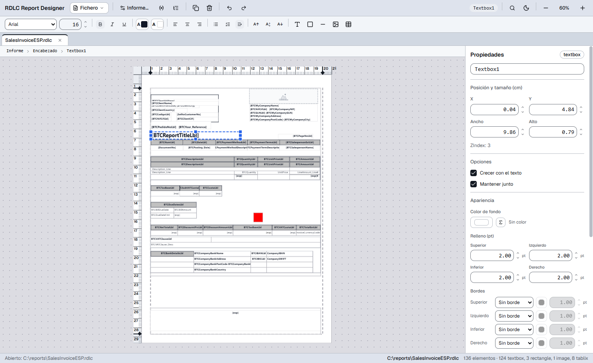

<div align="center">

# RDLC Report Designer

**Visual editor for Business Central `.rdlc` and SSRS `.rdl` reports.**
A modern alternative to Report Builder: edit the layout with your mouse and get XML that saves **without altering anything you didn't touch**.

**RDCL Report Designer MCP server:** let an AI agent (Claude Code, Claude Desktop, Cursor…) create and edit reports without opening the app — [setup](#mcp-server--edit-reports-from-an-agent).


[](./LICENSE)


<picture>
  <source media="(prefers-color-scheme: dark)" srcset="docs/assets/screenshot-dark.png">
  
</picture>

</div>

---

## Why

Report Builder is deprecated and Business Central `.rdlc` files are edited by hand today or with tools that rewrite the whole file. RDLC Report Designer:

- opens real BC reports and **saves them byte for byte identical** except for what you changed.
- validates against the official **RDL 2016/01 XSD** before saving.
- is compatible with what **Report Builder and BC** expect when opening the report.

## Features

| Area                         | What it includes                                                                                                                                                                   |
| ---------------------------- | ---------------------------------------------------------------------------------------------------------------------------------------------------------------------------------- |
| **Faithful to the file**     | _Lossless_ XML as the source of truth: byte-for-byte round-trip (10/10 corpus reports), byte-exact undo, XSD validation on import and save.                                        |
| **Canvas**                   | Paper, margins and bands, mm/cm rulers, snapping, 1 pt / 10 pt arrows, zoom up to 400 %, multi-selection, 8 handles, z-order, viewport culling (≈60 fps with ~1000 textboxes).     |
| **Full Tablix**              | Cells, rows and columns, merge/split cells, row and column groups (Matrix), totals, visibility, filters, Report Builder-style headers, headers and corner.                         |
| **Text and style**           | Runs and paragraphs with `run > paragraph > item` precedence, format bar, fonts available in BC, per-side borders, padding, literal or expression background color, number format. |
| **Expressions**              | Monaco with highlighting and autocomplete for expressions and for the `<Code>` block (VB), variable panel with search.                                                             |
| **Productivity**             | Command palette <kbd>Ctrl</kbd>+<kbd>K</kbd>, context menu, copy/cut/paste, duplicate, drag-to-insert from the toolbar, light/dark theme.                                          |
| **Multiple reports at once** | One tab per report with independent undo, _dirty_ state and conflict; reorder, batch close and "Save all".                                                                         |
| **Resilient**                | Live reload if the file changes outside, recovery after a UI crash, conflict warning when saving and deleted-file warning.                                                         |
| **Secure**                   | Electron with sandbox, `contextIsolation`, navigation/windows/permissions blocked and trusted file paths only if the user chose them.                                              |
| **Formats**                  | Business Central `.rdlc` and SSRS `.rdl` (2016/01 schema).                                                                                                                         |

## Installation

Download the installer from the repository's **Releases** section:

| File                                              | Use                      |
| ------------------------------------------------- | ------------------------ |
| `RDLC-Report-Designer-<version>-setup.exe`        | Classic installer (NSIS) |
| `RDLC-Report-Designer-<version>.msi`              | Corporate deployment     |
| `RDLC-Report-Designer-<version>-portable.exe`     | No installation          |
| `RDLC-Report-Designer-<version>-win-unpacked.zip` | Ready-to-run folder      |

> Installers are only signed if the pipeline has the certificate; an unsigned build shows the Windows SmartScreen warning. Details in [docs/release](./docs/release/0001-empaquetado-windows.md).

You can also open a report from the command line or by dragging it onto the window:

```bash
"RDLC Report Designer.exe" C:\path\to\report.rdlc
```

## MCP server — edit reports from an agent

The repo ships a [Model Context Protocol](https://modelcontextprotocol.io) server (stdio) that lets an AI agent (Claude Code, Claude Desktop, Cursor…) create and edit `.rdlc`/`.rdl` layouts **without opening the app**: no GUI, no Electron. It runs the same editing engine as the desktop app, so the agent works with the same typed commands as the UI and keeps every guarantee: byte-for-byte round-trip, byte-exact undo, measure normalization and RDL 2016 XSD validation on save.

Published on npm as [`@jjp00/rdlc-designer-mcp`](https://www.npmjs.com/package/@jjp00/rdlc-designer-mcp) (requires Node.js 22+).

### Setup

**Claude Code:**

```bash
claude mcp add rdlc-designer -- npx -y @jjp00/rdlc-designer-mcp
claude mcp add rdlc-designer -- cmd /c npx -y @jjp00/rdlc-designer-mcp   # native Windows (not WSL)
```

Add `--scope user` for all your projects, or `--scope project` to write a shared `.mcp.json`.

**Other agents** (Claude Desktop, Cursor, VS Code, Codex…):

```jsonc
// Claude Desktop (claude_desktop_config.json), Cursor (.cursor/mcp.json)
{
  "mcpServers": {
    "rdlc-designer": { "command": "npx", "args": ["-y", "@jjp00/rdlc-designer-mcp"] },
  },
}
```

```jsonc
// VS Code (.vscode/mcp.json)
{
  "servers": {
    "rdlc-designer": {
      "type": "stdio",
      "command": "npx",
      "args": ["-y", "@jjp00/rdlc-designer-mcp"],
    },
  },
}
```

```toml
# Codex CLI (~/.codex/config.toml)
[mcp_servers.rdlc-designer]
command = "npx"
args = ["-y", "@jjp00/rdlc-designer-mcp"]
```

### Tools

| Tool                         | Purpose                                                                                    |
| ---------------------------- | ------------------------------------------------------------------------------------------ |
| `rdlc_open` / `rdlc_create`  | Open an existing `.rdlc`/`.rdl` or create a blank one (won't overwrite unless `overwrite`) |
| `rdlc_list_sessions`         | Open sessions, dirty state, version                                                        |
| `rdlc_get_report`            | Page, regions, item counts, dataset fields, parameters, VB code (`includeCode`)            |
| `rdlc_get_outline`           | Layout map (`region`, `id`, `maxLines` to bound it)                                        |
| `rdlc_get_item`              | Full JSON of one item                                                                      |
| `rdlc_list_commands`         | Signatures of all commands, or the exact JSON Schema of the named ones (`names`)           |
| `rdlc_apply_commands`        | Apply a list of commands in order (`atomic`)                                               |
| `rdlc_undo` / `rdlc_redo`    | Session journal                                                                            |
| `rdlc_save` / `rdlc_save_as` | Save (validates the schema) or save a copy                                                 |
| `rdlc_reload` / `rdlc_close` | Re-read from disk discarding changes / close (`force` discards changes)                    |

Edits live in memory until `rdlc_save`. Dataset fields and parameters are read-only: in Business Central they come from the AL report dataset, so add the column in AL, compile, and re-open the regenerated `.rdlc`. Warnings that are dialogs in the GUI (conflict, deleted file, external reload) reach the agent as `notices` in the session's next response.

> Notes: only `.rdlc`/`.rdl` (2016/01 schema) files are accepted; the server has the file access of the process that launches it, so work on copies until you trust it; `RDLC_SCHEMA_PATH` overrides the bundled XSD. More in [docs/features/0004-servidor-mcp.md](./docs/features/0004-servidor-mcp.md) and the [package README](./packages/rdlc-mcp/README.md).

<details>
<summary><b>From the repo (development, no publish needed)</b></summary>

```bash
pnpm --filter @rdlc-designer/back build:mcp     # → apps/back/out/mcp/server.mjs
claude mcp add rdlc-designer -- node C:/path/to/ReportDesigner/apps/back/out/mcp/server.mjs

pnpm --filter @jjp00/rdlc-designer-mcp build    # → packages/rdlc-mcp/dist + resources
pnpm --filter @jjp00/rdlc-designer-mcp smoke    # npm pack + clean install + stdio check
```

</details>

## Development

**Requirements:** Node.js ≥ 22 and pnpm 9 (`npm install -g pnpm@9.15.4`).

```bash
pnpm install
pnpm --filter @rdlc-designer/back dev     # Electron in dev mode (renderer HMR)
```

| Command                                   | What it does                                                          |
| ----------------------------------------- | --------------------------------------------------------------------- |
| `pnpm test`                               | Unit tests (Vitest): golden round-trip, domain, application, frontend |
| `pnpm e2e`                                | Playwright against the Electron app (builds `out/` and runs the E2E)  |
| `pnpm typecheck`                          | `tsc` across all packages                                             |
| `pnpm lint` · `pnpm format:check`         | Lint and format                                                       |
| `pnpm --filter @rdlc-designer/back build` | Production build (main + preload + renderer)                          |
| `pnpm dist`                               | Windows installers (NSIS + MSI) in `apps/back/release/`               |
| `pnpm dist:dir`                           | Unpacked app, for a smoke test without an installer                   |

### Architecture

```
apps/back/            Electron main + NestJS (hexagon: domain / application / presentation / infrastructure)
apps/front/           React 19 — Tailwind v4 + shadcn/ui (radix-nova) + Konva
packages/contracts/   zod: shared commands, projection and IPC
packages/rdlc-mcp/    MCP server package (@jjp00/rdlc-designer-mcp)
fixtures/corpus/      10 real reports for the golden tests
docs/                 ADRs, performance, packaging, UX, bugs and feature designs
```

The renderer never touches the XML: it sends typed **commands** to the backend, which applies them to the _lossless_ tree (with their inverse for undo) and returns a **projection** to paint. More in the [architecture documentation](./RDLC%20Report%20Designer%20-%20arquitectura.md) and the ADRs: [lossless XML parser](./docs/adr/0001-parser-xml-lossless.md) · [NestJS in the main process](./docs/adr/0002-nest-en-electron-main.md).

<details>
<summary><b>Troubleshooting</b></summary>

- **`Error: Electron uninstall` when starting in dev:** pnpm didn't run Electron's postinstall. Download the binary manually: `node apps/back/node_modules/electron/install.js`.
- **The app starts as Node and fails with `does not provide an export named 'BrowserWindow'`:** the `ELECTRON_RUN_AS_NODE` environment variable is set in your terminal. Remove it (`Remove-Item Env:ELECTRON_RUN_AS_NODE`) and launch again.

</details>

<details>
<summary><b>Canvas benchmark</b></summary>

```bash
# 3 passes of the 972-textbox scenario on the production build
pnpm --filter @rdlc-designer/back bench
# Different size / number of passes: node apps/back/scripts/bench.mjs 5000 5
```

Current result: **59.5–59.9 fps p50** with 972 textboxes (budget 60). Details in [docs/perf](./docs/perf/0001-baseline-lienzo.md).

</details>

<details>
<summary><b>QA mode: screenshots and scripts against the real app</b></summary>

Electron can open a report, run a script in the renderer and take a screenshot without touching anything by hand. That's how the screenshots in this README were generated.

```powershell
$env:RDLC_OPEN='C:\path\to\report.rdlc'     # file to open at startup
$env:RDLC_SHOT='C:\path\to\output.png'      # screenshot when done
$env:RDLC_SHOT_DELAY='6000'                 # ms before running the script
$env:RDLC_SHOT_DRAG='x1,y1,x2,y2'           # previous drag/click (window px)
$env:RDLC_SHOT_SCRIPT='...'                 # JS to evaluate in the renderer
$env:RDLC_SHOT_QUIT='1'                     # quit when done
pnpm --filter @rdlc-designer/back dev
```

In dev (and in the `--mode e2e` build) the renderer exposes hooks for scripts: `__rdlcSelection`, `__rdlcCell`, `__rdlcMenuHit`, `__rdlcResizeHandle`, `__rdlcStage` and `__rdlcProjection`. Interaction tests live in Playwright (`pnpm e2e`).

</details>

## Documentation

> The linked docs are currently in Spanish.

- [Functional documentation](./RDLC%20Report%20Designer.md)
- [Architecture](./RDLC%20Report%20Designer%20-%20arquitectura.md)
- [Development status](./docs/estado-desarrollo.md): phases, sessions and recent changes
- [Backlog](./RDLC%20Report%20Designer%20-%20Pendientes.md)
- [Packaging and CI](./docs/release/0001-empaquetado-windows.md)
- [MCP server](./docs/features/0004-servidor-mcp.md): edit `.rdlc` from an agent (Claude Code…)

## License

[MIT](./LICENSE) © 2026 JunPeng Jin
